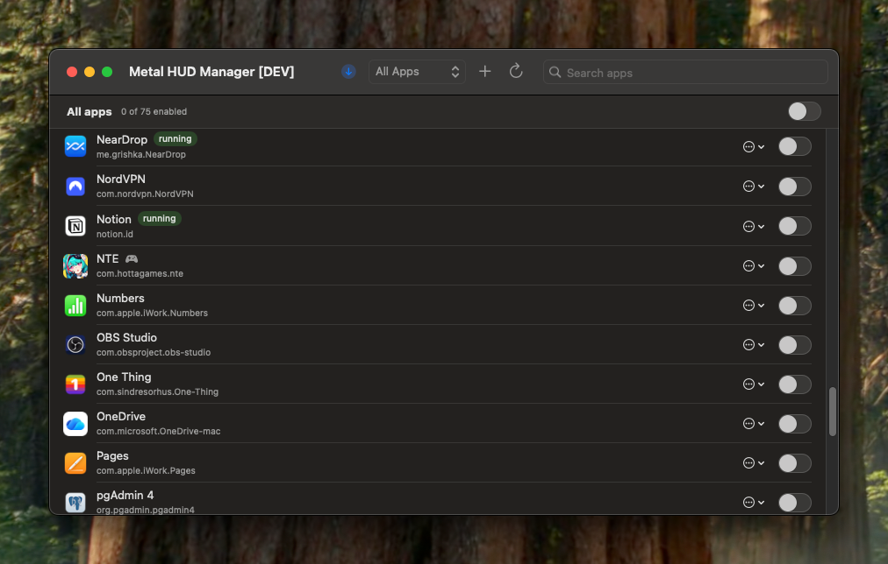

# Metal HUD Manager

A small macOS app to turn Apple's **Metal Performance HUD** (FPS, frame time, GPU memory, etc.) on **per application**, instead of globally for every app that happens to draw with Metal.



## Why

macOS can show the Metal HUD system-wide with:

```bash
defaults write -g MetalForceHudEnabled -bool YES
```

That works, but the overlay then also appears in browsers, Electron apps and other non-games. Metal HUD Manager lets you pick exactly which apps get it.

## Features

- Lists apps from `/Applications`, `~/Applications` and your Steam library, with icon and bundle ID
- One switch per app to enable the HUD persistently, plus an "all apps" switch that applies to everything currently shown
- **Launch once with HUD**: starts an app with the `MTL_HUD_ENABLED=1` environment variable, without saving anything (handy for apps that ignore the per-app setting)
- Shows which apps are running and offers a one-click restart so changes take effect
- Detects the global setting and lets you switch it off
- Search, a filter for **All Apps / Games / HUD Enabled**, and **Add App…** for apps in other locations
- Detects likely games (App Store games category, game controller support, Steam installs, Unity/Unreal/Godot builds); use **Mark as Game** / **Not a Game** in the **…** menu to correct it
- Checks GitHub for a newer release on launch and shows a download button with the changelog when one is available

## Requirements

- macOS 13 Ventura or later
- To build from source: Xcode or the Command Line Tools (`xcode-select --install`)

## Installation

### Option 1: Build from source (recommended)

```bash
git clone https://github.com/RuggeDX/MetalHUDManager.git
cd MetalHUDManager
scripts/build-app.sh --install
```

This builds `Metal HUD Manager.app` and copies it to `/Applications`. Without `--install` the app ends up in `./build/`.

### Option 2: Download a release

Download the latest `.dmg` from the [Releases](../../releases) page, open it, and drag **Metal HUD Manager** into the **Applications** folder. A `.zip` is available too if you prefer.

The release builds are **not notarized** by Apple, so macOS will block the first launch. To allow it, open the app once, then go to **System Settings → Privacy & Security** and click **Open Anyway**. Alternatively, remove the quarantine flag yourself:

```bash
xattr -dr com.apple.quarantine "/Applications/Metal HUD Manager.app"
```

## Usage

1. Open Metal HUD Manager.
2. If a banner says the HUD is enabled globally, click **Turn off global**.
3. Flip the switch next to each app where you want the HUD.
4. Restart the app (use **Restart to apply** if it's already running).

The **…** menu on each row has **Launch once with HUD** for a one-off session with the overlay.

## How it works

The app writes the `MetalForceHudEnabled` preference into each selected app's own defaults domain, the per-app equivalent of:

```bash
defaults write com.example.game MetalForceHudEnabled -bool YES
```

Turning a switch off deletes that key again. "Launch once with HUD" uses `NSWorkspace` to start the app with `MTL_HUD_ENABLED=1` in its environment.

## Notes and limitations

- Most apps pick up the per-app setting, but some (certain sandboxed apps, Wine/CrossOver wrappers) don't. Use **Launch once with HUD** for those.
- On recent macOS versions, changing settings for sandboxed apps can trigger a prompt asking whether Metal HUD Manager may access data from other apps. Allow it, or those switches won't stick.
- On launch the app makes one request to the GitHub API to check for a newer release. Nothing else is sent.
- Locally built copies are signed ad-hoc, so macOS may ask for that permission again after a rebuild.

## Reset everything

To remove all HUD settings this app has made, switch every app off in the app, or run:

```bash
defaults delete -g MetalForceHudEnabled 2>/dev/null
defaults delete com.example.game MetalForceHudEnabled   # per app
```

## Development

```bash
scripts/dev.sh
```

Compiles a debug build, runs it, and rebuilds and relaunches it every time you save `Sources/MetalHUDManager.swift`. Use `scripts/dev.sh --once` to just build and run. Prefix it with `MHM_MOCK_UPDATE=1` to preview the update button and dialog with a fake release. The dev build runs as a bare binary (no icon, separate settings); use `scripts/build-app.sh` to test the real app.

In VS Code, **⇧⌘B** starts the live dev build, and **Terminal → Run Task…** has tasks for the mock-update preview, installing a release build, and building the DMG. With the recommended [Code Runner](https://marketplace.visualstudio.com/items?itemName=formulahendry.code-runner) extension, the ▶ button in the editor title bar runs the open script in `scripts/` (`dev.sh`, `build-app.sh`, `make-dmg.sh`), or starts the dev build when a Swift file is open.

## Building releases

Pushing a tag starting with `v` triggers the GitHub Actions workflow, which builds a universal (Apple Silicon + Intel) app and attaches a `.dmg` and a `.zip` to a GitHub release. To build the disk image locally, run `scripts/make-dmg.sh` after `scripts/build-app.sh`.

Add a section for the version to [CHANGELOG.md](CHANGELOG.md) first: the workflow uses it as the release notes (check with `scripts/release-notes.sh 1.2.0`), and the app shows it in its update dialog.

```bash
git tag v1.2.0
git push origin v1.2.0
```

## License

[MIT](LICENSE)
